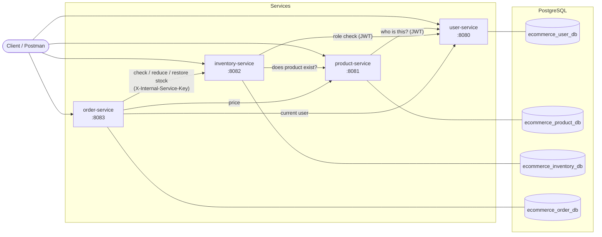

# E-Commerce Microservices Platform

[](https://github.com/meesalagit/ecommerce-microservices-platform/actions/workflows/ci.yml)


A backend for an online store, split into four Spring Boot microservices. Each service owns its own PostgreSQL database, and they talk to each other over REST. Users sign in with JWT, admins manage the catalog and stock, and placing an order checks stock, reduces it, and rolls it back if the order can't be saved.

## Architecture



| Service | Port | Responsibility |
|---|---|---|
| **user-service** | 8080 | Registration, login (issues JWT), profile, admin user management |
| **product-service** | 8081 | Product catalog. Anyone can browse, only ADMIN can change |
| **inventory-service** | 8082 | Stock per product. Verifies the product exists before stocking it |
| **order-service** | 8083 | Places orders by calling the other three services |

### How an order is placed

1. order-service calls user-service `/users/me` with the caller's JWT to find out who is ordering
2. Gets the product price from product-service
3. Asks inventory-service if enough stock is available
4. Reduces stock in inventory-service
5. Saves the order. **If saving fails, it calls inventory-service again to restore the stock** (compensating action), so stock never goes missing

Calls between order-service and inventory-service's stock endpoints carry an `X-Internal-Service-Key` header, so only order-service can reduce or restore stock.

## Tech stack

- **Java 25**, Spring Boot (3.5 for user-service, 4.x for the others)
- Spring Web, Spring Data JPA / Hibernate, Spring Security, Bean Validation
- **JWT** authentication (jjwt) with **BCrypt** password hashing, `USER` / `ADMIN` roles
- Spring **RestClient** for service-to-service calls
- **PostgreSQL 17**, one database per service
- **JUnit 5, Mockito, AssertJ**, Spring `MockRestServiceServer`
- **Docker** (multi-stage builds) and **Docker Compose**
- **GitHub Actions** CI

## Run it with Docker

You need Docker Desktop. Nothing else, not even Java.

```bash
git clone https://github.com/meesalagit/ecommerce-microservices-platform.git
cd ecommerce-microservices-platform

cp .env.example .env      # then edit .env and set your own values
docker compose up --build
```

This starts Postgres (on host port **5433**, so it won't clash with a local Postgres), creates the four databases, and starts all four services. The first build takes a few minutes while Maven downloads dependencies.

Stop everything with `Ctrl + C`, or `docker compose down`. Add `-v` to also wipe the database.

### Configuration

Secrets are never committed. Docker reads them from `.env`:

| Variable | What it is |
|---|---|
| `POSTGRES_USER` / `POSTGRES_PASSWORD` | Database login |
| `JWT_SECRET` | Key used to sign tokens. At least 32 characters, same for every service |
| `INTERNAL_SERVICE_KEY` | Shared key between order-service and inventory-service |

To run a service from an IDE instead, create `src/main/resources/secrets.properties` in that service (it's git-ignored) with `spring.datasource.password`, `jwt.secret`, and `internal.service.key`.

## Try it out

Every new account is created as `USER`. To try the admin endpoints, promote your account once:

```bash
docker compose exec postgres psql -U postgres -d ecommerce_user_db \
  -c "UPDATE users SET role='ADMIN' WHERE email='admin@test.com';"
```

Then in Postman (or curl):

```text
POST http://localhost:8080/users          {"firstName":"Admin","lastName":"Test","email":"admin@test.com","password":"Admin@123"}
POST http://localhost:8080/users/login    {"email":"admin@test.com","password":"Admin@123"}   -> copy "token"

# Send the token as:  Authorization: Bearer <token>
POST http://localhost:8081/products       {"name":"Laptop","description":"MacBook Air","price":999.99,"category":"Electronics"}
POST http://localhost:8082/inventory      {"productId":1,"quantity":10}
POST http://localhost:8083/orders         {"productId":1,"quantity":2}
GET  http://localhost:8082/inventory/1    -> quantity is now 8
```

## API endpoints

### user-service (8080)

| Method | Endpoint | Access |
|---|---|---|
| POST | `/users` | Public (register) |
| POST | `/users/login` | Public (returns JWT) |
| GET | `/users/me` | Logged in |
| PUT | `/users/me` | Logged in |
| DELETE | `/users/me` | Logged in |
| GET | `/users/{id}` | Logged in |
| GET | `/admin/users` | ADMIN |
| GET / PUT / DELETE | `/admin/users/{id}` | ADMIN |

### product-service (8081)

| Method | Endpoint | Access |
|---|---|---|
| GET | `/products` | Public |
| GET | `/products/{id}` | Public |
| GET | `/products/search?name=` | Public |
| GET | `/products/category?name=` | Public |
| POST | `/products` | ADMIN |
| PUT | `/products/{id}` | ADMIN |
| DELETE | `/products/{id}` | ADMIN |

### inventory-service (8082)

| Method | Endpoint | Access |
|---|---|---|
| POST | `/inventory` | ADMIN |
| GET | `/inventory/{productId}` | Logged in |
| PUT | `/inventory/{productId}?quantity=` | ADMIN (adds stock) |
| GET | `/inventory/{productId}/available?quantity=` | Internal key |
| PUT | `/inventory/{productId}/reduce?quantity=` | Internal key |
| PUT | `/inventory/{productId}/restore?quantity=` | Internal key |

### order-service (8083)

| Method | Endpoint | Access |
|---|---|---|
| POST | `/orders` | Logged in |

## Tests

Each service has service-layer unit tests written with **JUnit 5 and Mockito**. Repositories are mocked, so the tests run in milliseconds without a database. For inventory-service and order-service, Spring's `MockRestServiceServer` stands in for the other services, which makes it possible to test failure cases like:

- product-service returning 404, or being down
- not enough stock, so the order is rejected and stock is never reduced
- the order failing to save, so the inventory restore call is made

| Service | Unit tests |
|---|---|
| user-service | 13 |
| product-service | 12 |
| inventory-service | 10 |
| order-service | 3 |

Run them for one service:

```bash
cd user-service
./mvnw test -Dtest='*ServiceTest'
```

Running `./mvnw test` without the filter also runs the `contextLoads` test, which starts the full app and needs a PostgreSQL database.

## CI

[`.github/workflows/ci.yml`](.github/workflows/ci.yml) runs on every push and pull request to `main`. It builds all four services in parallel on Java 25, each with its own PostgreSQL service container, and runs the full test suite (`./mvnw verify`), including the `contextLoads` tests.

## Project structure

```text
ecommerce-microservices-platform/
├── user-service/          Spring Boot app + Dockerfile
├── product-service/
├── inventory-service/
├── order-service/
├── docker/
│   └── init-databases.sql   creates the 4 databases on first start
├── docker-compose.yml
├── .env.example             template for secrets (copy to .env)
└── .github/workflows/ci.yml
```
